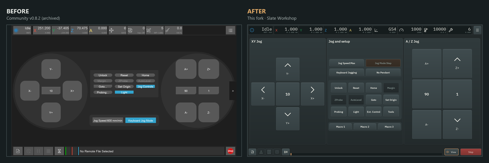
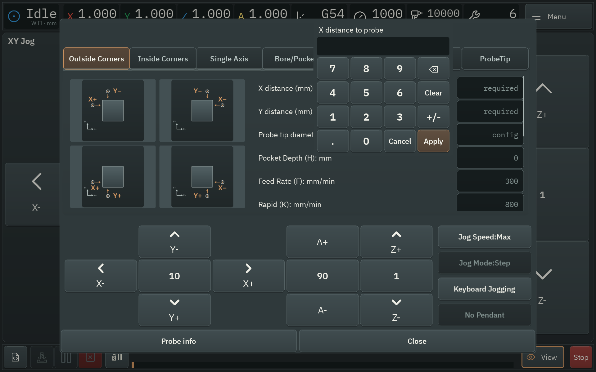
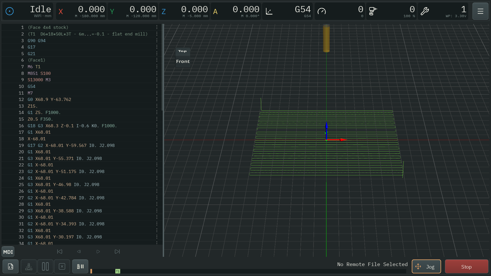

# Carvera Controller: Pat’s Raspi 4 Kiosk Fork

A [Community Carvera Controller](https://github.com/Carvera-Community/Carvera_Controller) fork for running a **Raspberry Pi 4 touchscreen kiosk** beside a Carvera or Carvera Air. It boots directly into the controller and includes an on-screen keyboard, numeric entry pads, and laptop maintenance tools.

Built around Pat’s **1920 × 1200 touchscreen**, with a redesigned interface and improvements to touch controls. Desktop and Android builds are also available from source.

I use and test this fork on my **Carvera Air**. Your mileage may vary on other machines.

[Set up a kiosk](#install-the-kiosk) · [Hardware](#hardware) · [Firmware](#firmware) · [Features](#controller-improvements) · [Other platforms](#desktop-and-android) · [Development](docs/development.md)

## Raspberry Pi kiosk

- Boots into the controller on 64-bit Debian Linux.
- Provides touch jogging, numeric pads, a text keyboard, and adjustable interface size.
- Supports laptop diagnostics, logs, backups, and optional screen sharing over SSH.
- Preserves preferences during app updates and restores the previous release if startup fails.

### Hardware

| Part | Target setup |
| --- | --- |
| Computer | Raspberry Pi 4 |
| Display and enclosure | [XBONFIRE 10.1-inch HDMI touchscreen/enclosure](https://www.amazon.com/dp/B0DDL5VMZF) |
| Resolution | 1920 × 1200 (16:10), approximately 60 Hz |
| Storage | SD card, 8 GB or larger |

**The kiosk targets this display resolution.** Its display tools accept 1920 × 1200 and a 1920 × 1080 comparison mode, both near 60 Hz. The screen must advertise the selected mode. Other resolutions need changes to the display setup and may need layout adjustments.

For another resolution, [open an issue](https://github.com/prdoring/Carvera_Controller/issues) with your display model and resolution. Support can be added on request; further work will follow demand.

### Firmware

**Built for use with [Carvera Community Firmware 2.2.0c](https://github.com/Carvera-Community/Carvera_Community_Firmware)**, the version used on Pat’s Carvera Air (CA1).

This fork does not require its own machine firmware. Installing the kiosk does not by itself require reflashing the mill. The [recorded device tests](docs/raspberry-pi-android-performance.md) cover the Android controller on 2.2.0c.

Features depend on the firmware reported by the machine. Higher USB baud rates require community firmware 2.1.0 or newer. Live vacuum-power controls require firmware that reports external-output state and power.

## Install the kiosk

Use **Carvera Kiosk Setup** from a [full release](https://github.com/prdoring/Carvera_Controller/releases)
that contains `setup-release.json`. Legacy and app-only releases cannot install
this graphical setup. Until a complete compatible release is published, use the
[developer build instructions](docs/development.md#kiosk-desktop-tools).

### 1. Open Setup on your computer

Download the Setup installer for **Windows 11 x64**, or the `.deb` for **Debian
12+ / Ubuntu 24.04+**, choosing x64 or ARM64 to match your computer. Portable
downloads are also provided. Verify the download against that release's
`SHA256SUMS`. Initial Windows downloads are unsigned previews.

Open Setup as your normal desktop user. It includes its own runtime and card
writer; installing Python, Git, Docker, OpenSSH or Raspberry Pi Imager is not
part of the graphical workflow.

### 2. Install and configure a card

Keep your working card for recovery and insert the new card. Choose **Install
on a new card**. Follow **Card → Network → Access → Review → Install**:

- Select the physical card and a compatible full release. Setup can download the
  image, or use an offline image with matching `setup-release.json`.
- Choose Ethernet or WPA-personal Wi-Fi, a kiosk name and country. Optionally
  import an exported preferences backup.
- Enter and confirm a private passphrase. Setup creates separate encrypted
  maintenance and administrator keys in a unique folder under your `.ssh` folder.
  The administrator account has full control of the Pi.
- Grant the card worker administrator permission when asked. After verification,
  check the card's identity and capacity again and explicitly approve erasure.
  Wait for configuration and safe ejection to finish.

If Windows asks to format the Linux partition, choose **Cancel**. A completed
flash followed by failed configuration is reported separately; reopen the saved
profile to retry configuration without reflashing. Use **Configure an
already-flashed card** only for a fresh v3 image. Existing kiosks use the
[migration workflow](docs/kiosk-administration.md#migrate-an-existing-card).

### 3. Check first boot

Insert the card into the Pi, keep the mill disconnected, and power on. First
boot makes the card's available storage usable, applies setup and removes the
temporary Wi-Fi payload. If setup fails, a limited status screen shows recovery
information while the controller remains stopped.

In Setup, choose **Check first boot** and open the saved profile. Compare the SSH
fingerprint with the touchscreen before trusting it. Setup checks the installed
image and component versions, both accounts and administrator access. It can
set a private local recovery password. Physically test keyboard login with
**Ctrl+Alt+F2**, then return to the kiosk with **Ctrl+Alt+F1**.

The finish screen shows your key locations and connection details, and links to
the separate **Carvera Kiosk Screen Share** download. Screen Share uses the
verified profile and maintenance key, with explicit Connect/Disconnect controls.
See the [setup guide](docs/kiosk-setup.md) for offline setup and recovery.

### 4. Connect the mill when ready

The controller starts disconnected. Tap **Connect** and select USB or a network
connection. **Opening a USB connection resets the mill.**

## Laptop maintenance

From the extracted laptop folder, use the same hostname or IP address you used for SSH:

~~~bash
python kiosk.py diagnose --host carvera-admin@carvera-pi.local
python kiosk.py logs --host carvera-admin@carvera-pi.local
python kiosk.py backup --host carvera-admin@carvera-pi.local preferences.tar.gz
~~~

The backup command saves preferences to your computer.

For an **existing card**, follow [migration without reflashing](docs/kiosk-administration.md#migrate-an-existing-card):
capture identity online, shut down safely, make two independent verified whole-card
backups, stage on the identified boot partition and run the dedicated migration
boot. Do not use `prepare-card` on an already provisioned installation.

The [administration guide](docs/kiosk-administration.md) covers separate System
updates, rollback, local-console recovery, keys and SSH-tunneled screen access.
Updates require maintenance and operator readiness; broken-controller recovery
requires physical disconnection. Failed storage retains an offline recovery path.

## Controller improvements

### Interface and touch controls

The Slate Workshop theme adds dark panels, consistent controls, new icons, and redrawn probing illustrations. Touch layouts cover job setup, probing, facing, CMM, settings, and file browsing.

- Enter signed decimal values with the number pad.
- Keep fields and confirmation buttons above the keyboard.
- Jog with one controlling finger. Sliding off stops movement; sliding back does not restart it.
- Viewer gestures, scrolling, and playback scrubbing stay with the finger that started them.
- Find file actions directly in the browser and adjust the interface size to suit the display.

More screenshots: [compact jog screen](docs/screenshots/fork/touch-control.png), [touchscreen preview](docs/screenshots/fork/touch-preview.png), [probing](docs/screenshots/fork/touch-probing.png), and [facing wizard](docs/screenshots/fork/touch-facing.png).

### Connections and responsiveness

Android has native USB serial support, including the FTDI adapter in Pat’s Carvera Air setup, and can reconnect using a saved adapter identity.

Network connection setup and G-code preparation run in the background. Optional dialogs load when first opened to reduce startup work. Large previews can still cause pauses.

### Vacuum controls

The spindle dropdown provides **50–100%** live vacuum-power adjustment when compatible firmware reports that the external output is on. The control is disabled when status is missing or stale.

Carvera Air settings also expose the default vacuum power for **Auto Ext. Out**. Reset the machine after applying that default.

## Community features

The fork retains advanced 3D probing, WHB04-family pendant support, keyboard jogging, work coordinate management, configurable autolevel areas, job setup backgrounds, custom tool numbers, facing, CMM tools, and a rotary-aware G-code preview.

Availability depends on the machine, firmware, and accessories. Advanced 3D probing needs a suitable touch probe. Tool-changing features need ATC hardware; a factory Carvera Air does not have an ATC.

## Desktop and Android

### Run from source on Windows, Linux, or macOS

Install **Python 3.9–3.13**, **Git**, and [Poetry](https://python-poetry.org/docs/#installation). Python 3.12 matches CI. On Debian/Ubuntu, install these dependencies first:

~~~bash
sudo apt-get install python3-dev build-essential libhidapi-hidraw0 mtdev-tools
~~~

On Windows, the `pyquicklz` dependency may need Visual C++ build tools to compile.

~~~bash
git clone https://github.com/prdoring/Carvera_Controller.git
cd Carvera_Controller
poetry install --without ios-dev
poetry run python -m carveracontroller
~~~

### Build for Android

From the checkout, in a prepared Linux build environment:

~~~bash
poetry install --without ios-dev
poetry run python scripts/build.py --os android --version 2.2.0-DEV
~~~

Install the resulting `dist/carveracontroller-community-2.2.0-DEV.apk` on the device. USB connections need USB host support, a data cable or adapter, and device permission.

The [Windows and Android guide](docs/windows-android-development.md#android-build-command) covers build prerequisites, installation, and signing. Back up preferences before replacing an existing app; a different signing key can prevent an in-place update.

## Build a kiosk image

To build from source, see [Raspberry Pi kiosk image](docs/development.md#raspberry-pi-kiosk-image). This requires Git and Docker Desktop with Linux containers.

## Development and support

[Development and packaging](docs/development.md) covers checks, translations, and packaging. Use [this fork’s issue tracker](https://github.com/prdoring/Carvera_Controller/issues) for bugs or requests. For bugs, include your platform, controller revision, machine model, firmware version, and steps to reproduce.

The [community documentation](https://carvera-community.gitbook.io/docs/controller/about) covers shared features. [CONTRIBUTING.md](CONTRIBUTING.md) is the community contribution guide.

Thanks to Makera and the Carvera Community contributors. See [LICENSE](LICENSE), [NOTICE](NOTICE), and [Privacy](PRIVACY.md).
