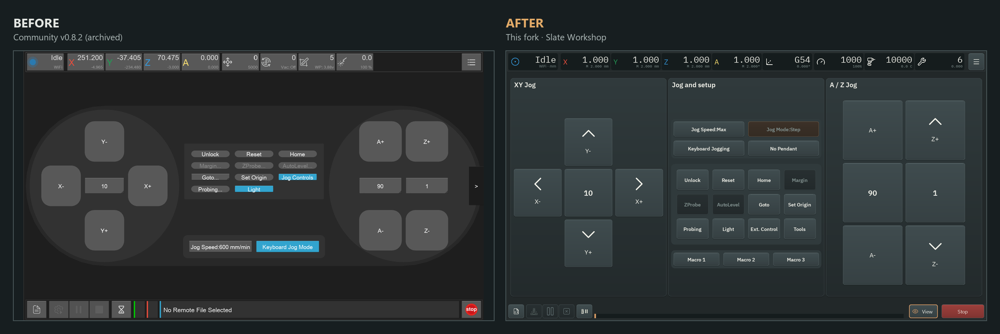
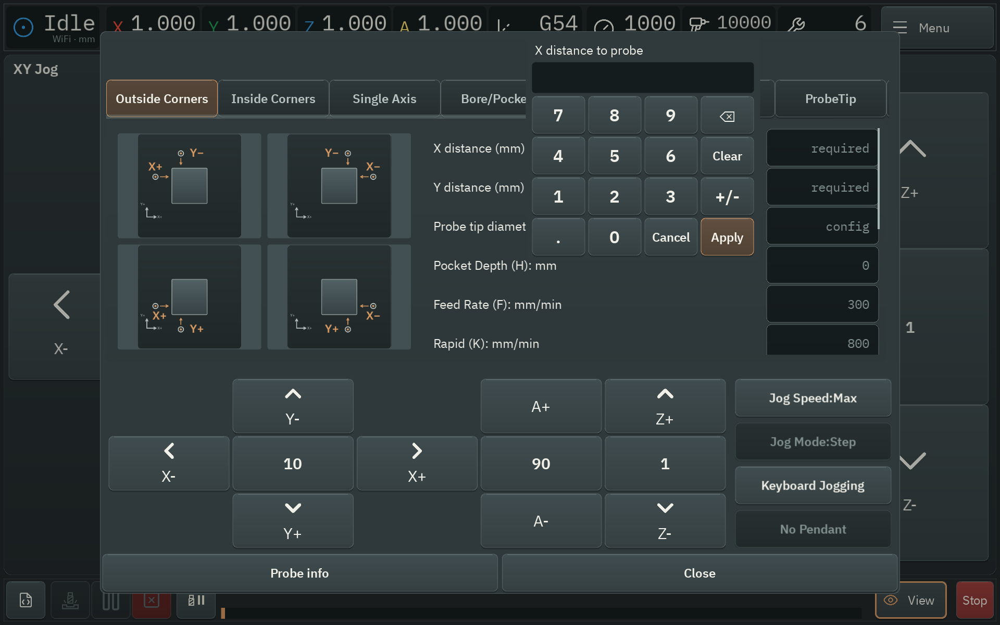
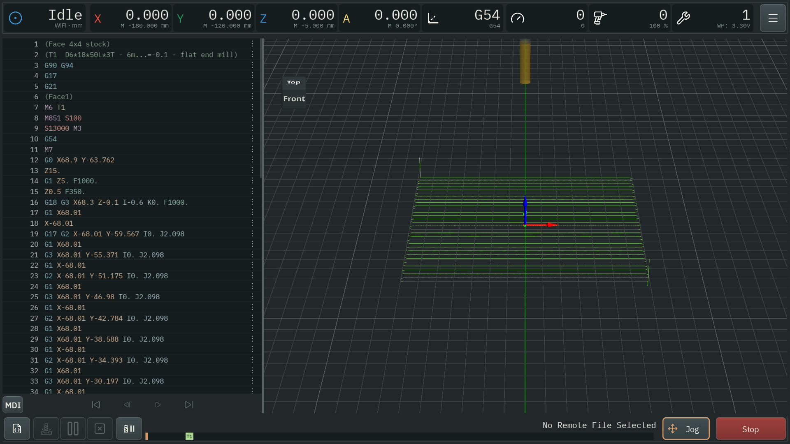

# Carvera Controller: Pat’s Raspi 4 Kiosk Fork

A [Community Carvera Controller](https://github.com/Carvera-Community/Carvera_Controller) fork for running a **Raspberry Pi 4 touchscreen kiosk** beside a Carvera or Carvera Air. It boots directly into the controller and includes an on-screen keyboard, numeric entry pads, and laptop maintenance tools.

Built around Pat’s **1920 × 1200 touchscreen**, with a redesigned interface and improvements to touch controls. Desktop and Android builds are also available from source.

I use and test this fork on my **Carvera Air**. Your mileage may vary on other machines.

[Set up a kiosk](#install-the-kiosk) · [Hardware](#hardware) · [Firmware](#firmware) · [Features](#controller-improvements) · [Other platforms](#desktop-and-android) · [Development](docs/development.md)

## Raspberry Pi kiosk

- Boots into the controller on 64-bit Debian Linux.
- Provides touch jogging, numeric pads, a text keyboard, and adjustable interface size.
- Supports laptop diagnostics, logs, backups, and optional screen sharing over SSH.
- Preserves preferences during app updates and restores the previous release if startup fails.

### Hardware

| Part | Target setup |
| --- | --- |
| Computer | Raspberry Pi 4 |
| Display and enclosure | [XBONFIRE 10.1-inch HDMI touchscreen/enclosure](https://www.amazon.com/dp/B0DDL5VMZF) |
| Resolution | 1920 × 1200 (16:10), approximately 60 Hz |
| Storage | SD card, 8 GB or larger |

**The kiosk targets this display resolution.** Its display tools accept 1920 × 1200 and a 1920 × 1080 comparison mode, both near 60 Hz. The screen must advertise the selected mode. Other resolutions need changes to the display setup and may need layout adjustments.

For another resolution, [open an issue](https://github.com/prdoring/Carvera_Controller/issues) with your display model and resolution. Support can be added on request; further work will follow demand.

### Firmware

**Built for use with [Carvera Community Firmware 2.2.0c](https://github.com/Carvera-Community/Carvera_Community_Firmware)**, the version used on Pat’s Carvera Air (CA1).

This fork does not require its own machine firmware. Installing the kiosk does not by itself require reflashing the mill. The [recorded device tests](docs/raspberry-pi-android-performance.md) cover the Android controller on 2.2.0c.

Features depend on the firmware reported by the machine. Higher USB baud rates require community firmware 2.1.0 or newer. Live vacuum-power controls require firmware that reports external-output state and power.

## Install the kiosk

The kiosk is included on this fork’s main branch.

### Before you start

On your computer, install **Raspberry Pi Imager**, **Python 3.11+**, and the **OpenSSH client tools** (ssh, scp, and ssh-keygen).

You also need an SSH key pair for laptop access. If you do not already have one, run the following and accept the default file location:

~~~bash
ssh-keygen -t ed25519
~~~

The card setup below uses the public key at `~/.ssh/id_ed25519.pub`. Keep the private key on your computer.

### 1. Download the image and setup tools

Download [Pi Kiosk v1.0.0](https://github.com/prdoring/Carvera_Controller/releases/tag/kiosk-v1.0.0), the first prebuilt Raspberry Pi 4 kiosk release.

Download these files from its **Assets** section:

| File | Purpose |
| --- | --- |
| `carvera-kiosk-pi4-1.0.0.img.xz` | SD card image for the Raspberry Pi 4 |
| `carvera-kiosk-laptop-1.0.0.zip` | Card setup and laptop maintenance tools |
| `carvera-kiosk-app-1.0.0.tar.gz` | App update for an existing kiosk |
| `SHA256SUMS` | Checksums for verifying the downloads |

Compare the downloads with `SHA256SUMS` before using them. On Linux, run `sha256sum -c SHA256SUMS` beside all three downloads. On Windows, use `Get-FileHash <filename> -Algorithm SHA256` for each file and compare its hash.

Extract the laptop ZIP and open a terminal in its **laptop** folder, beside **kiosk.py**. Keep `kiosk.py`, `laptop-requirements.txt`, `README.md`, and the complete `novnc` folder together. Run the helper commands below from that folder. Git and Docker are only needed if you build the image yourself.

### 2. Flash and configure the card

In Raspberry Pi Imager, choose a custom image and select the downloaded `.img.xz`. Flash a spare card and keep your existing card for rollback. Skip Imager’s OS customization.

Before ejecting the card, configure its **bootfs** partition. Replace `E:/` with its actual drive or mount path, and change the public-key path, Wi-Fi name, and country to match your setup:

~~~powershell
python kiosk.py prepare-card --boot-dir E:/ --public-key ~/.ssh/id_ed25519.pub --hostname carvera-pi --ssid Workshop --country US
~~~

The helper prompts for your Wi-Fi password. For Ethernet, omit `--ssid` and `--country`. To import preferences from an exported Android app backup, add `--settings backup.tar.gz`.

### 3. Boot the Pi

Insert the card and power on the Pi. In **Settings → System**, find its network address and SSH fingerprint. From your computer, connect once:

~~~bash
ssh carvera-admin@carvera-pi.local
~~~

Compare the fingerprint with the touchscreen before accepting it. If the hostname does not resolve, use the IP address shown on the Pi. Once connected, type **exit** to return to your computer’s terminal.

### 4. Connect the mill

The controller starts disconnected. Tap **Connect** and select USB or a network connection. **Opening a USB connection resets the mill.** USB is the default for a fresh installation.

## Laptop maintenance

From the extracted laptop folder, use the same hostname or IP address you used for SSH:

~~~bash
python kiosk.py diagnose --host carvera-admin@carvera-pi.local
python kiosk.py logs --host carvera-admin@carvera-pi.local
python kiosk.py backup --host carvera-admin@carvera-pi.local preferences.tar.gz
~~~

The backup command saves preferences to your computer.

See the [kiosk guide](https://github.com/prdoring/Carvera_Controller/blob/main/assets/packaging/kiosk/README.md) for screen-sharing setup, Wi-Fi recovery, app deployment, and rollback. Updates require maintenance mode and an idle machine. Full OS updates use a replacement card image.

## Controller improvements

### Interface and touch controls

The Slate Workshop theme adds dark panels, consistent controls, new icons, and redrawn probing illustrations. Touch layouts cover job setup, probing, facing, CMM, settings, and file browsing.

- Enter signed decimal values with the number pad.
- Keep fields and confirmation buttons above the keyboard.
- Jog with one controlling finger. Sliding off stops movement; sliding back does not restart it.
- Viewer gestures, scrolling, and playback scrubbing stay with the finger that started them.
- Find file actions directly in the browser and adjust the interface size to suit the display.

More screenshots: [compact jog screen](docs/screenshots/fork/touch-control.png), [touchscreen preview](docs/screenshots/fork/touch-preview.png), [probing](docs/screenshots/fork/touch-probing.png), and [facing wizard](docs/screenshots/fork/touch-facing.png).

### Connections and responsiveness

Android has native USB serial support, including the FTDI adapter in Pat’s Carvera Air setup, and can reconnect using a saved adapter identity.

Network connection setup and G-code preparation run in the background. Optional dialogs load when first opened to reduce startup work. Large previews can still cause pauses.

### Vacuum controls

The spindle dropdown provides **50–100%** live vacuum-power adjustment when compatible firmware reports that the external output is on. The control is disabled when status is missing or stale.

Carvera Air settings also expose the default vacuum power for **Auto Ext. Out**. Reset the machine after applying that default.

## Community features

The fork retains advanced 3D probing, WHB04-family pendant support, keyboard jogging, work coordinate management, configurable autolevel areas, job setup backgrounds, custom tool numbers, facing, CMM tools, and a rotary-aware G-code preview.

Availability depends on the machine, firmware, and accessories. Advanced 3D probing needs a suitable touch probe. Tool-changing features need ATC hardware; a factory Carvera Air does not have an ATC.

## Desktop and Android

### Run from source on Windows, Linux, or macOS

Install **Python 3.9–3.13**, **Git**, and [Poetry](https://python-poetry.org/docs/#installation). Python 3.12 matches CI. On Debian/Ubuntu, install these dependencies first:

~~~bash
sudo apt-get install python3-dev build-essential libhidapi-hidraw0 mtdev-tools
~~~

On Windows, the `pyquicklz` dependency may need Visual C++ build tools to compile.

~~~bash
git clone https://github.com/prdoring/Carvera_Controller.git
cd Carvera_Controller
poetry install --without ios-dev
poetry run python -m carveracontroller
~~~

### Build for Android

From the checkout, in a prepared Linux build environment:

~~~bash
poetry install --without ios-dev
poetry run python scripts/build.py --os android --version 2.2.0-DEV
~~~

Install the resulting `dist/carveracontroller-community-2.2.0-DEV.apk` on the device. USB connections need USB host support, a data cable or adapter, and device permission.

The [Windows and Android guide](docs/windows-android-development.md#android-build-command) covers build prerequisites, installation, and signing. Back up preferences before replacing an existing app; a different signing key can prevent an in-place update.

## Build a kiosk image

To build from source, see [Raspberry Pi kiosk image](docs/development.md#raspberry-pi-kiosk-image). This requires Git and Docker Desktop with Linux containers.

## Development and support

[Development and packaging](docs/development.md) covers checks, translations, and packaging. Use [this fork’s issue tracker](https://github.com/prdoring/Carvera_Controller/issues) for bugs or requests. For bugs, include your platform, controller revision, machine model, firmware version, and steps to reproduce.

The [community documentation](https://carvera-community.gitbook.io/docs/controller/about) covers shared features. [CONTRIBUTING.md](CONTRIBUTING.md) is the community contribution guide.

Thanks to Makera and the Carvera Community contributors. See [LICENSE](LICENSE), [NOTICE](NOTICE), and [Privacy](PRIVACY.md).
