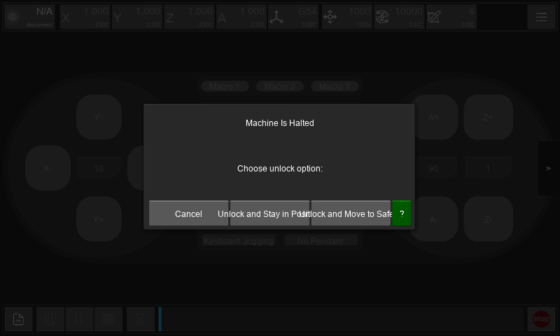
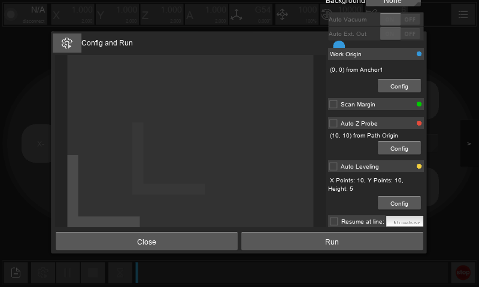
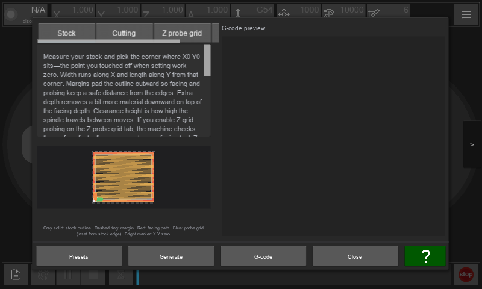

# Mobile and small-touchscreen UX audit

Date: October 14, 2026.

Application: Carvera Community Controller 2.2.0.

Source reference: `v2.2.0`, with checkout base
`e5623ece10309597d43a708dde35ae41c7854cb8`. The main layout, probing, facing,
CMM layouts, and custom settings widgets matched the release sources.
Unrelated USB work was present in the checkout and was preserved.

Related report: [Android touch support audit](android-touch-audit.md).

Status: the original audit is complete. The October 15 candidate was not
accepted after visual review. The October 22 corrections and their validation
are recorded below. The user has released the Pi; replacement and physical
machine acceptance are still pending.

## Main conclusion

The application scales a desktop interface to fit the display. It rarely
changes the arrangement or amount of information shown as usable space
decreases. This keeps many controls on screen at the cost of readable text,
clear choices, and room to complete a task.

The most important improvements are:

1. Keep setup options and motion-related choices readable and reachable.
2. Adapt navigation and panel arrangements to available space.
3. Provide mobile layouts for files, job setup, probing, CMM, and facing.
4. Standardize dialogs, editing, validation, and progress feedback.
5. Respect text scaling and preserve useful machine context during workflows.

Some problems are visible at the application's default Android scale. Others
appear when enlarging the interface for readability. Increasing the UI scale
alone does not solve the underlying layout constraints.

## Scope and evidence

This report covers layout, navigation, information hierarchy, readability,
task completion, editing, recovery, and platform differences. The separate
touch report documents pointer ownership, jogging release, keyboard
composition, and gesture defects in more detail.

The source inventory covered all 23 Kivy layout files, their 116 widget rules,
Python-built dialogs, shared widgets, configuration schemas, and Android/iOS
packaging. Representative local renders captured 36 distinct views. Coverage
below distinguishes rendered examples from source-only variants.

Rendering used the current Kivy widgets in a hidden local desktop process.
Background Python workers and network connections were disabled, reconnect
was disabled, and application settings were isolated to temporary directories.
Dialogs were opened directly with disconnected or synthetic data. No motion,
transfer, update, or connection action was invoked.

The Raspberry Pi, its Android connection, its application, and its settings
were not accessed or changed. Another session was working on that device.

The principal comparison was an 800 by 480 framebuffer with Kivy density 0.8,
which matches the Android startup density formula for an 800 by 480 display.
A density-1.0 comparison examined the consequences of a larger UI scale.
Windows display scaling was accounted for to capture the requested framebuffer
dimensions. These are local layout renders, not screenshots from an Android
APK. Native keyboards, permission screens, mobile lifecycle, actual font
preferences, and device input were not tested.

Existing documentation screenshots showing older releases were inspected for
context but were not used as evidence of the current UI.

## Screen coverage

**R** means a representative current widget layout was rendered and inspected.
It does not mean every state, tab, or platform branch was exercised.
**S** means source inspection, including variants of a shared rendered layout.

| Screen or surface | Coverage | Main mobile improvement |
| --- | --- | --- |
| Application status bar and bottom action bar | R + S | Prioritize essential values, explain coordinate modes, and keep status readable |
| Main navigation menu and side page switch | R + S | Visible destination names and current-page indication |
| Manual control and jog controls | R + S | Compact arrangement with clear jog mode, step, speed, and separated actions |
| Connection/status menus, Wi-Fi and USB selection | S | Explicit connection state, labeled choices, and recovery guidance |
| X/Y/Z/A menus | S | Bounded action sheets with units and clear consequences |
| Coordinate-system dropdown | S | Explicit active workspace and readable activation/edit actions |
| Feed, spindle, laser, tool and collet menus | S | Readable overrides, units, distinct actions, and capability-aware content |
| File/viewer page | R initial + S loaded state | One useful pane at a time on compact layouts; clear preview-versus-run context |
| MDI console | R + S | A usable editor above the keyboard, visible send/history controls |
| Remote file browser | R + S | Fewer simultaneous toolbar actions, selection mode, metadata beneath names |
| Local file browser | R + S | Explain View, Upload, and Upload and Select; simplify path navigation |
| Local load/save picker and directory shortcuts | S | Mobile file import/export, bounded breadcrumbs, keyboard-aware save controls |
| Config and Run / Margin / ZProbe / Leveling | R representative + S variants | Scrollable or staged setup, readable review, reachable options |
| Origin configuration | R + S | Short vertical choices with explicit coordinate context |
| Z-probe and XYZ-probe dialogs | R + S | Legible numeric entry and clear probe-direction/context labels |
| Auto-level configuration | R + S | Bounded content; grid and offsets must stay inside the dialog |
| Set X/Y/Z/A, Move A, Set Tool, Change Tool | R Set X/Set Tool + S variants | Shared numeric editor with units, validation and explicit action names |
| WCS settings | R + S | Workspace list/detail editing; visible validation and activation semantics |
| Rotation dialog | R + S | Clearly labeled degrees, reference frame, and completed-value validation |
| Probing: Outside Corners, Inside Corners, Single Axis, Bore/Pocket, Boss/Block, Angle, ProbeTip, Calibration, 4th Axis | R initial tab + S all tabs | Discoverable operation chooser and readable parameters; preserve feature restrictions |
| Probe preview/execution console | R + S | Operation summary, readable output, persistent Halt and progress |
| Advanced calibration | R + S | Readable purpose, numeric fields, and a clear Run Calibration action |
| CMM: Manual, Touch, Bore, Boss, Corner in, Corner out, Angle | R Manual + S all tabs | Separate capture, preview, and construction on compact displays |
| CMM jog overlay | R + S | Preserve width bounding; cap height and retain reliable motion cancellation |
| CMM feature rows, rename, construction and exports | S | Feature detail actions, disambiguation, visible save state, platform export parity |
| Facing: Stock, Cutting, Z probe grid, Tool / Misc. | R Stock + S all tabs | Step-based entry, concise help, review on demand, visible generation state |
| Facing presets and G-code output menus | S | Preserve existing bounded dialogs; clarify output destination and next step |
| Diagnostics | R + S | Grouped outputs with readable labels, state and reasons for disabled controls |
| Settings: Controller, G-Code Viewer, Pendant, Machine Basic/Advanced/Restore/Backup | R initial Controller + S other categories | Compact category selection, search, readable value editors, mobile availability |
| Color picker and macro editors | S; settings-row layout R | Prevent value/action overlap; provide simple colors and keyboard-aware G-code editing |
| Pendant/gamepad configuration and permission error | R gamepad + S variants | Larger binding rows, explicit listening state, clear save/cancel and recovery |
| Generic input, manual Wi-Fi, password and language dialogs | R representative + S callers | Full-width entry, field purpose, password controls and keyboard-aware actions |
| Confirmation, unlock and probe-selection dialogs | R + S | Fully readable choices and explicit consequences |
| Wireless probe pairing | R + S | Readable state/countdown; preserve C1-only navigation condition |
| Message, progress and reconnection dialogs | R + S | Scrollable details, clear progress/cancel state, recovery action |
| Controller/firmware updates and compatibility warnings | R update tabs + S dynamic warnings | Explain platform restrictions and distinguish checking, download and installation |
| Camera panel, image adjustments and legend overlays | S | Separate from the compact viewer; preserve capability gating |
| `SettingPage` placeholder | S | Label-only legacy page; actual Settings navigation opens `ConfigPopup` |

Rendered conditional dialogs are examples of layout, not proof that a feature
is supported or reachable on a particular machine. Preserve C1/CA1 differences,
reported ATC and rotary capabilities, firmware requirements, and camera
availability. An Air with user-installed hardware must follow its actual
configuration rather than assumptions based only on its model name.

## Prioritized findings

### UX-01: Use layout changes as space decreases

Priority: high. Evidence: source and renders.

Android startup replaces Kivy density using screen width and height, fitting a
roughly 1000 by 550 layout. iPhone startup has a similar scaling path. Most
screens retain the same columns, tabs, and toolbar actions. Proportional sizes,
scrolling, and a bounded CMM jog width exist, but there is no shared policy
that changes the main arrangements for compact windows.

Introduce compact, medium, and expanded arrangements based on usable window
space and readable control sizes. Compact layouts should usually present one
main task pane; larger layouts can retain simultaneous views. Handle short
landscape windows as well as narrow widths. Use real display units rather than
the overridden density to classify space.

Android and the checked iOS packaging declare landscape orientations. Keep
landscape kiosk use working. Portrait support needs an explicit product
decision and a corresponding layout before enabling rotation.

Sources: [main.py](../carveracontroller/main.py), startup density handling;
[makera.kv](../carveracontroller/makera.kv);
[buildozer.spec](../buildozer.spec);
[iOS orientation configuration](../assets/packaging/ios/carveracontroller-ios/carveracontroller-Info.plist).
Design reference: [Android adaptive navigation](https://developer.android.com/develop/ui/views/layout/build-responsive-navigation).

### UX-02: The status bar cannot simply grow for readability

Priority: high. Evidence: rendered comparison and source.

The top bar keeps many status cells in one row. `TopDataView` has a 90dp minimum
width; the row also contains gaps and the menu button. At 800 by 480 with
density 1.0, cells overflow the right edge and the menu is lost. At density 0.8,
the row fits by displaying very small secondary values.

Work coordinates are the main values and machine coordinates are the secondary
values, but the distinction is not labeled in the compact cells. Important
information should remain understandable without remembering the order.

Keep connection/state and the most useful coordinates visible. Move secondary
values and overrides to a labeled detail panel or additional row. Clearly label
Work and Machine coordinates, units, the active WCS, and applicable rotation.
Reserve navigation space rather than giving it whatever remains.

Sources: [makera.kv](../carveracontroller/makera.kv), `TopDataView` and `TopBar`;
[main.py](../carveracontroller/main.py), status updates.
Evidence: [default scale](mobile-ux-audit-images/control-default.png),
[larger scale](mobile-ux-audit-images/control-larger-scale.png).

### UX-03: Primary navigation depends on unlabeled icons and an arrow

Priority: high. Evidence: rendered and source.

The function menu renders as a vertical strip of icons. Most entries have an
empty `text` value and explain their destination through a hover tooltip.
The page switch is a side button labeled only `<` or `>`. It also occupies
content space while providing no destination name or selected-page indication.

Provide visible navigation labels such as Control, Files and More, with a clear
current destination. Present secondary tools in a labeled menu. Separate page
navigation from job execution controls so both remain understandable.
Centralize Back and dialog navigation while preserving draft input and scroll
position. Pointer and Android Back issues are also covered by the touch audit.

Sources: [makera.kv](../carveracontroller/makera.kv), `FuncDropDown`, `IconButton`
and the side page-switch button.
Evidence: [navigation menu](mobile-ux-audit-images/navigation-menu.png).

### UX-04: The control screen uses space unevenly

Priority: medium. Evidence: rendered and source.

Large axis-control areas surround a much denser central group containing
macros, machine actions, tool access and jog configuration. Percentage-sized
spacers coexist with minimum-height groups. Enlarging the UI can push the
central actions behind the status bar while the axis panels remain visible.

Create a compact control layout with an intentional balance between axis
buttons and settings. Keep jog mode, step, speed and active input source close
to the controls they affect. Group setup, machine-state actions and custom
macros separately. Explain why disabled actions are unavailable rather than
requiring users to infer the machine state or feature restriction.

Source: [makera.kv](../carveracontroller/makera.kv), `ControlPage`.

### UX-05: Job setup options overflow before the user can review them

Priority: high. Evidence: rendered and source.

Config and Run reserves a fixed 200dp column beside the workspace illustration.
Its many fixed-height sections have no surrounding scroll container. In the
800 by 480, density-0.8 render, the column extends above the dialog and beyond
the screen. Auto-level configuration also renders content beyond its nominal
dialog bounds.

All relevant settings must be reachable before committing the operation. Use a
scrollable setup body or staged steps with a final review. Present the selected
file, origin/WCS, enabled margin/probing/leveling operations, relevant tool and
resume line together. Treat the illustration as expandable supporting content
on compact displays. Keep the action footer inside the available window.

Sources: [makera.kv](../carveracontroller/makera.kv), `CoordPopup`,
`AutoLevelPopup`, and related origin/probe configuration;
[main.py](../carveracontroller/main.py), corresponding configuration classes.
Evidence: [job setup](mobile-ux-audit-images/job-setup.png),
[auto-level](mobile-ux-audit-images/auto-level.png).

### UX-06: Different motion choices have overlapping labels

Priority: high. Evidence: rendered at the default-equivalent scale.

The unlock dialog places Cancel, Unlock and Stay in Position, and Unlock and
Move to Safe Z in one row inside a half-width dialog. The latter labels overlap
and become hard to distinguish. Probe selection similarly places long tool
choices in one row, with text spilling into adjacent buttons.

Use vertically arranged, full-width choices with wrapping labels and a short
explanation of the effect. Name the consequential action explicitly. Keep
Cancel separate and consistently positioned. Apply the same principle to
tool-change, clearing, reset, restore and resume confirmations.

Sources: [makera.kv](../carveracontroller/makera.kv), `UnlockPopup` and
`SelectAndCalibrateProbePopup`.
Evidence: [unlock](mobile-ux-audit-images/unlock.png),
[probe selection](mobile-ux-audit-images/select-probe.png).

### UX-07: File workflows carry too many desktop controls at once

Priority: high. Evidence: rendered and source.

The remote browser puts location, Rename, Delete, New Folder and Upload File in
one fixed-width toolbar. The local browser simultaneously presents View,
Upload, Upload and Select, and Close. Both retain separate date/size columns
and breadcrumb/search rows. Long names and paths compete with these controls.

Use readable filename rows with secondary metadata underneath on compact
layouts. Move less common actions to a labeled overflow menu. Show a clear
selection mode and selected-item count. Shorten breadcrumbs visually while
preserving access to the complete path.

Clarify whether a file is on this device or on the mill, whether it is preview
only, and what is selected for execution. Keep the existing Upload and Select
workflow, but make its purpose and next step obvious. An empty list should
distinguish no files from loading, filtering, disconnection or an access failure.

Sources: [makera.kv](../carveracontroller/makera.kv), `FilePopup`;
[main.py](../carveracontroller/main.py), local/remote file selection and transfer.
Evidence: [remote browser](mobile-ux-audit-images/remote-files.png),
[local browser](mobile-ux-audit-images/local-files.png).

### UX-08: Preview, console and overlays need compact alternatives

Priority: medium. Evidence: initial page rendered; loaded states source-inspected.

The File page keeps a list/console pane beside the viewer, with a narrow
splitter. Viewer controls, a fixed-width legend, and conditional camera
controls can occupy additional space. Displaying all of these together reduces
the useful area for each task.

Allow compact users to choose Preview, Lines or Console, preserving their
position between views. Keep a visible way to show viewer controls. Move the
legend and camera adjustments into an expandable panel when space is limited.
Retain the existing split view and resizable panes for larger windows.

The camera is conditional on detected support. Do not infer its availability
on the user's C1 or CA1 from the existence of the panel. Loaded toolpaths,
legends and camera streams need later device validation.

Sources: [makera.kv](../carveracontroller/makera.kv), `FilePage`;
[GcodeColorSchemePanel.kv](../carveracontroller/ui/GcodeColorSchemePanel.kv);
[CameraControls.kv](../carveracontroller/addons/camera/CameraControls.kv).

### UX-09: MDI needs a mobile editing workflow

Priority: medium. Evidence: rendered and source; native keyboard untested.

The console editor is a small part of the split File page. Its hint advertises
Control+Enter, while history navigation relies on arrow keys. A Send button
exists, but the surrounding layout offers limited room for a software keyboard
and multiline commands.

Provide an expandable editor that remains useful above the keyboard, a visible
Send action and touch-accessible history. Preserve drafts when moving between
console and preview. Display command status and validation near the editor.
Suspend motion shortcuts during editing. Implement keyboard/focus fixes from
the touch audit alongside the new layout.

Sources: [makera.kv](../carveracontroller/makera.kv), `ManualCMDPage`;
[main.py](../carveracontroller/main.py), `MDITextInput`.

### UX-10: WCS editing mixes a dense grid with unclear validation semantics

Priority: high. Evidence: rendered and source.

WCS settings keeps eight columns for workspace selection, offsets, rotation,
clearing and descriptions. It is vertically scrollable, but it does not reflow
into readable workspace details on compact displays.

There are also two different commitment models: tapping a WCS name executes an
activation command immediately, while numeric edits wait for Save/OK. Invalid
numeric values are skipped by `apply_changes`; the OK binding then dismisses
the dialog without field-specific feedback. Clear All changes the draft
values, so its effect should be explained in that same editing model.

Use a workspace list and a detail editor. Label activation as an immediate
action, distinguish active workspace from the one being edited, and show units.
Validate all edited values before applying, retain invalid drafts with an
inline explanation, and keep the dialog open until the user resolves them.
Preserve existing change tracking and discard labels.

Sources: [makera.kv](../carveracontroller/makera.kv), `WCSSettingsPopup`;
[main.py](../carveracontroller/main.py), `apply_changes`, `activate_wcs`,
`clear_all_wcs`, and `check_for_changes`.

### UX-11: Probe operation discovery and parameter entry compete for space

Priority: medium. Evidence: first tab rendered; all nine tab layouts inspected.

Probing offers nine horizontal operation tabs and shows direction diagrams,
parameters and jog controls in the same dialog. Several tabs are off screen
until horizontal scrolling. Dense parameter rows use small text, abbreviated
names and G-code parameter letters. Increasing scale causes label clipping.

Use a discoverable operation chooser and separate selection, parameter entry,
and review where space requires it. Show descriptive names and units first,
with parameter codes as supporting information. Keep jog access available
without permanently allocating a large portion of every operation screen.
Preserve tool, firmware and optional-axis restrictions.

Sources: [ProbingPopup.kv](../carveracontroller/addons/probing/ProbingPopup.kv),
[ProbingControls.kv](../carveracontroller/addons/probing/ProbingControls.kv),
and the nine [operation settings layouts](../carveracontroller/addons/probing/operations/).
Evidence: [probing](mobile-ux-audit-images/probing.png).

### UX-12: Motion workflows need a clearly reachable software Halt

Priority: high. Evidence: source; physical behavior untested.

Modal views intercept touches outside their content, including the application
Stop control visible behind them. Probe preview supplies its own Halt action
while running, which is a useful existing pattern. CMM instead exposes Close,
then a confirmation to discard the result; that confirmation cancels the probe
operation. This makes stopping dependent on a less obvious, multi-step route.

Provide a clear, persistent Halt/Cancel Operation action in an active operation
view, with feedback that distinguishes stopping from stopped. Separate stopping
motion from leaving the screen or discarding data. Keep controls inside the
visible bounds during keyboard and window changes.

This concerns software control accessibility. No physical stop behavior was
tested. Motion cancellation defects in the touch audit remain prerequisites.

Sources: [makera.kv](../carveracontroller/makera.kv), application Stop;
[ProbingPreviewPopup.kv](../carveracontroller/addons/probing/preview/ProbingPreviewPopup.kv);
[CMMWorkbenchPopup.py](../carveracontroller/addons/cmm_workbench/ui/CMMWorkbenchPopup.py),
`dismiss` and `_confirm_dismiss_while_probing`;
Kivy 2.3.1 `ModalView` touch dispatch.

### UX-13: CMM needs separate capture, preview and construction views

Priority: high. Evidence: rendered and source.

CMM keeps seven operation tabs on the left and preview, eight construction
actions and feature rows on the right. Several tabs are hidden horizontally.
The manual form's position/load row has fixed widths; larger UI scaling clips
it. Construction button labels are cramped even before a session contains data.
Load, Save as, Copy as, Reset, Jog, Close and Help share a footer.

On compact displays, separate capture from the feature list/preview. Put
construction actions with selected features and explain selection requirements.
Use readable feature details and a clear save state. Keep Jog as a bounded
overlay; its existing width limit is useful, but its height follows content
without a corresponding available-height cap.

Sources: [CMMWorkbenchPopup.kv](../carveracontroller/addons/cmm_workbench/ui/CMMWorkbenchPopup.kv),
[CMMWorkbenchPopup.py](../carveracontroller/addons/cmm_workbench/ui/CMMWorkbenchPopup.py).
Evidence: [CMM](mobile-ux-audit-images/cmm.png).

### UX-14: Facing starts with help instead of the required inputs

Priority: medium. Evidence: rendered and source.

Facing keeps four tabs and a sketch in a narrow left pane, while an initially
empty G-code preview occupies the larger right pane. In the default-equivalent
render, the Stock tab's long help paragraph fills the initial viewport and
pushes its required fields below it. Some explanatory text is only 9dp.

Present Stock, Cutting, optional Probing, and Tool/Output as clear steps. Put
essential fields first, offer concise contextual help, and expand diagrams or
the program preview on demand. Make generated/current/out-of-date state visible
before the user chooses an output action. Preserve the existing stale-program
confirmation and viewport-bounded preset dialogs.

Sources: [FacingWizardPopup.kv](../carveracontroller/addons/facing/FacingWizardPopup.kv),
[FacingWizardPopup.py](../carveracontroller/addons/facing/FacingWizardPopup.py).
Evidence: [facing](mobile-ux-audit-images/facing.png).

### UX-15: Settings needs compact navigation and consistent value editors

Priority: medium. Evidence: rendered and source.

Settings uses Kivy's fixed 200dp sidebar. The remaining width must fit setting
titles, descriptions, values and custom action buttons. The rendered color
setting already shows crowded value/action text. Configuration spans Controller,
G-Code Viewer, Pendant and conditional machine panels.

Use a category list or selector on compact displays, with a full-width detail
view and search. Put values beneath descriptions when necessary. Reuse a shared
mobile editor for numeric, text, option, color and macro settings. Bound option
lists by the available window height and scroll their content; Kivy's default
option popup computes height from the number of choices.

The C1 schema contains 93 entries and the CA1 schema 70, including section
titles. Actual exposed settings depend on the reported configuration. Keep the
existing deferred Apply/discard behavior and review changed values before
machine settings are applied.

Sources: [main.py](../carveracontroller/main.py), `MakeraConfigPanel`,
`DeferredSettingsPanel`, and `ConfigPopup`;
[custom_widgets.py](../carveracontroller/custom_widgets.py);
[controller settings](../carveracontroller/controller_config.json),
[C1 schema](../carveracontroller/config_c1.json),
[CA1 schema](../carveracontroller/config_ca1.json);
Kivy 2.3.1 `MenuSidebar` and `SettingOptions`.
Evidence: [settings](mobile-ux-audit-images/settings.png).

### UX-16: Diagnostics and device configuration need grouped detail screens

Priority: medium. Evidence: diagnostics and gamepad rendered; related source inspected.

Diagnostics presents many switches, sliders and state values in one dialog.
On a small screen, users must interpret both the abbreviated control name and
whether it is available. Gamepad bindings already has a scrollable list and a
separate Save/Cancel footer, but its 36dp rows and multiple controls per row
remain small.

Group diagnostics by function, place measured state beside the related control,
and explain restrictions. For bindings, use larger rows or a detail editor,
with an unmistakable waiting-for-input state and cancellation. Preserve the
existing practice of pausing the gamepad manager while configuring it.

Sources: [makera.kv](../carveracontroller/makera.kv), `DiagnosePopup`;
[pendant.py](../carveracontroller/addons/pendant/pendant.py), `GamepadBindingsPopup`.
Evidence: [gamepad bindings](mobile-ux-audit-images/gamepad-bindings.png).

### UX-17: Save, import and export behavior differs by platform and workflow

Priority: medium. Evidence: source; platform journeys untested.

The main iOS file-selection path uses a native picker. CMM explicitly disables
Load and Save as on iOS, while Copy as remains available. Generic local save
dialogs use a directory chooser and filename field. Android storage shortcuts
can open the system all-files permission screen. Mobile machine backup controls
are also disabled or omitted.

Make available destinations explicit and give a useful explanation or
alternative when an operation is unavailable. Investigate native document
import/export for reusable features, preserving permissions and confirming
completion. Keep Copy as as a useful option. Show unsaved state consistently
for CMM sessions, macro editing, facing presets and settings, and retain drafts
during temporary navigation.

Source restrictions establish current behavior; they do not prove that native
mobile export is impossible. Any Android permission-flow change needs its own
device validation after the other session's work is complete.

Sources: [main.py](../carveracontroller/main.py), file selection and machine
settings panels; [Utils.py](../carveracontroller/Utils.py), storage access;
[LocalFilePicker.py](../carveracontroller/ui/LocalFilePicker.py);
[CMMWorkbenchPopup.py](../carveracontroller/addons/cmm_workbench/ui/CMMWorkbenchPopup.py).

### UX-18: Readability and larger text need a shared policy

Priority: high. Evidence: source inventory and renders; device accessibility untested.

Of 175 explicit font-size declarations in the Kivy layouts, 127 use `dp`,
47 use `sp`, and one uses another expression. `dp` fonts do not follow Kivy's
user font-scale preference. Facing includes 9dp and 10dp text; status secondary
values use 11sp. The resolution-derived density can shrink these further.

Use a small, shared set of readable text sizes that respects font preferences.
Allow labels to wrap and containers to grow. Preserve the complete wording of
important choices and errors. Test larger text, long numbers, long filenames
and longer translations; no translated-language render or 150–200% font-scale
test was performed in this audit.

Confirm text contrast in enabled states and make state understandable with
words as well as color. Native screen-reader behavior and focus order were not
tested, and no project-specific accessibility bridge was found in the inspected
UI source. Treat TalkBack/VoiceOver names and navigation as an explicit
validation item rather than claiming support or failure from screenshots.

Sources: all layout files, particularly [makera.kv](../carveracontroller/makera.kv),
[facing](../carveracontroller/addons/facing/FacingWizardPopup.kv), and
[CMM](../carveracontroller/addons/cmm_workbench/ui/CMMWorkbenchPopup.kv).
Reference: [Android text scaling guidance](https://support.google.com/accessibility/android/answer/12159181).

### UX-19: Recovery and update screens need clearer states and readable detail

Priority: medium. Evidence: rendered and source.

Message, progress and reconnection dialogs generally use a half-width,
40%-height layout. Long paths, import warnings and compatibility explanations
can need more room than their non-scrollable labels provide. The generic
confirmation dialog already uses a scrollable body, offering a pattern to reuse.

Updates present separate Controller/Firmware tabs with checking, download and
update actions. Mobile backup is disabled in the firmware tab without an inline
explanation. The fixed firmware toolbar can also crowd its container.

Show a short status and next action, with expandable or scrollable detail.
Distinguish loading, waiting, cancelling, cancelled, failed and completed.
Keep progress and Cancel/Retry visible, and explain what cancelling affects.
For updates, name the target, current/new version, available backup route and
next step. Preserve compatibility checks rather than weakening them to simplify
the UI.

Sources: [makera.kv](../carveracontroller/makera.kv), `MessagePopup`,
`ProgressPopup`, `ReconnectionPopup`, `ConfirmPopup`, and `UpgradePopup`;
[main.py](../carveracontroller/main.py), compatibility and progress flows.

## Patterns worth preserving

- Confirmation text already scrolls and has a fixed action footer.
- WCS and Settings track changes; Settings supports deferred Apply and discard.
- Facing warns when generated G-code is stale and bounds preset-dialog height.
- Gamepad configuration uses a scrollable body, Save/Cancel, and pauses its manager.
- Forms in probing, facing and CMM already use scrolling in several places.
- CMM enlarges sketch hit areas and has a width-bounded jog overlay.
- The main iOS file-import path uses a native picker.
- Existing capability and firmware checks determine available operations.

Reuse these patterns as shared building blocks. A bounded dialog with a
scrollable body and a reachable action footer would improve several screens
without changing their machine operations.

## Recommended sequence

1. Fix overlapping consequential choices and overflowing job-setup dialogs.
   Address motion cancellation from the touch audit at the same time.
2. Establish shared readable sizing, bounded dialogs and adaptive navigation.
3. Adapt Control and the Files/Preview/MDI workflow for compact windows.
4. Adapt WCS, probing, CMM and facing around individual tasks and review steps.
5. Unify editing, errors, save state, recovery and import/export behavior.
6. Validate larger text, translations, capability combinations and real mobile
   workflows before submitting behavior changes.

## Validation matrix for implementation

Existing screenshot tests configure a desktop window at 1920 by 1080. They
help detect changes to that baseline but do not establish mobile layout or
Android behavior. This audit's local renders add layout evidence; they do not
replace those tests or real-device checks.

| Dimension | Cases to validate |
| --- | --- |
| Display and window | Actual Pi panel, small landscape phone, tablet, large desktop, resized/multi-window bounds where supported |
| Scaling | Android density, app UI override, default/150%/200% text, usable space above the keyboard |
| Content | Long translated labels, large signed coordinates, long paths/names, many files, many CMM features, lengthy error/update text |
| State | Disconnected, connecting, idle, active job, paused, alarm, waiting on communications, reconnecting, failure and completion |
| Machine capabilities | C1, CA1, optional rotary axis, ATC where actually present, firmware restrictions, conditional camera support |
| File-to-job workflow | Find/import, preview, upload/select, configure, review, start, monitor, pause/halt, recover and resume |
| Probing and CMM | Choose operation, edit parameters, position, review, start, halt, retain results, save/export and reopen |
| Editing | Inline invalid-value feedback, draft retention, correct commit/cancel behavior, keyboard dismissal and return |
| Platform | Android permission denial/return, native file flows, iOS export restrictions, background/resume and system bars |
| Accessibility | Readable enabled-state contrast, full labels, screen-reader names/focus order, color-independent state |

For each changed screen, require that every necessary setting and final action
is reachable, that important wording is fully readable, and that layout changes
preserve existing state and machine semantics. Changes affecting machine
behavior need controlled testing on a real C1 or CA1 with the affected feature.
Record the actual machine and effective configuration; a screenshot or build
does not validate motion.

## Supporting screenshots

All linked images are 800 by 480 local framebuffer renders using disconnected
or synthetic data. Density is 0.8 unless explicitly noted. They illustrate
layout evidence; they are not recordings of the user's Pi or of machine actions.

The unlock choices overlap at the default-equivalent scale:

Job-setup options extend above the visible dialog:

Facing initially presents help while required fields are below the viewport:

Other evidence:

- [Control at default-equivalent scale](mobile-ux-audit-images/control-default.png)
- [Control at density 1.0, with status/action overflow](mobile-ux-audit-images/control-larger-scale.png)
- [Icon-only navigation menu](mobile-ux-audit-images/navigation-menu.png)
- [Probe-selection choices](mobile-ux-audit-images/select-probe.png)
- [Auto-level layout](mobile-ux-audit-images/auto-level.png)
- [Probing parameters](mobile-ux-audit-images/probing.png)
- [CMM capture and construction](mobile-ux-audit-images/cmm.png)
- [Settings sidebar and value/action layout](mobile-ux-audit-images/settings.png)
- [Remote files](mobile-ux-audit-images/remote-files.png)
- [Local files](mobile-ux-audit-images/local-files.png)
- [Gamepad binding list and Save/Cancel footer](mobile-ux-audit-images/gamepad-bindings.png)

## Notes for later sessions

- Read this together with the [touch audit](android-touch-audit.md). Layout
  improvements alone will not correct its demonstrated input-event defects.
- Check the current checkout and preserve unrelated work. The audit does not
  authorize changing or interrupting another session's Pi activity.
- Source-only findings and untested platform behavior need targeted validation;
  do not describe them as reproduced device failures.
- Use actual available space, font preferences and capabilities when designing
  alternatives. Do not rely on shrinking the interface to make controls fit.
- Keep implementation narrowly tied to the chosen UX improvement and preserve
  existing compatibility and machine safeguards.

## Implementation verification (October 15, 2026)

This section records the earlier candidate. Its screenshots and APK are
superseded by the October 22 work below; it was never installed on the Pi.

The original renders above describe 2.2.0, before the Android touch work.
Current work builds on 3ef91ef. Android density, keyboard composition,
captured jog cancellation, file selection, viewer gestures and CMM sketch
zoom already have separate evidence in the touch audit.

The first landscape UX checkpoint replaces automatic outer scrolling with
explicit content viewports and fixed action rows for unlock, probe choice,
messages, reconnect and progress. Other forms retain their own viewports.
Local integration tests now replace physical transports, reconnect, discovery
and pendant access before constructing the application, and isolate probe
preferences as well as Kivy preferences. No Pi or mill was accessed.

Device acceptance for this work is pending the user's release of the device.

Job setup now owns a scrolling options column and a compact illustration toggle.
Numeric dialogs use explicit bodies and fixed actions. WCS has compact cards,
retains editor instances through reflow, and validates every applicable numeric
draft before any G10 command. Invalid or interrupted sends retain drafts.
Descriptions remain immediately saved and are excluded from numeric discard.
CMM has a separate Cancel probe action; cancellation invalidates results before
sending the existing abort and waits for a newer stopped-machine report.
Local WCS validation/reflow and cancellation transition tests pass. Actual
probe-stop behavior remains unverified for this change until machine testing.

Main-page work now labels navigation, separates compact Work coordinates from
machine details/overrides, wraps action text, and gives central actions an
independent scroll area while keeping jog configuration outside it. Preview,
lines, console, legend and supported camera controls have visible controls.
The console has touch history that fills without sending, a larger editor,
and explicit send feedback. File actions reuse their existing callbacks;
filenames carry secondary metadata, local directory reads run off the UI
thread, and access errors retain the current destination. Local renders found
and corrected zero-size-hint clipping and zero-width viewer projection errors.
Native keyboard and final device flows are still pending.

Tool-screen changes retain the existing operation tabs and add a compact
operation selector. Probing keeps settings deferred and uses full-width
parameter rows; compact jog controls replace the form while expanded and
cancel touch ownership when hidden. CMM exposes capture and features as
retained panes, places optional construction/sketch views in bounded dialogs,
and keeps Cancel probe directly available. Full JSON save/load controls its
unsaved-session indicator; clipboard and partial exports do not clear it.
Facing presents fields before optional help/sketch/program output and labels
missing, current and stale generation states. Local widget checks cover
operation selection, deferred panels and save-state changes. Physical probe
and jog acceptance remains pending.

### Final landscape changes

Settings now retains its existing panels and staged values, with a compact
category selector, search, and values beneath descriptions. Search hides rows
without removing their pending values. Text, numeric, option, color and macro
editors share bounded bodies and reachable actions. Diagnostic controls are
grouped as outputs and inputs; explanatory text scrolls with the controls.
Gamepad binding rows are larger and the waiting button cancels input capture.

Storage access opens only from an explicit action. The folder and filename
remain in their existing widgets through permission denial and return. Retry
reloads the same destination. Android save dialogs start in writable private
Controller files; Android's `/data` home directory is inaccessible to the app.
Shared storage remains available through explicit shortcuts and access grants.
Directory reads run in a worker and stale
responses cannot replace a newer folder request. Failed machine backups no
longer display an unconditional success message.

Display and font changes notify the retained layouts. Action rows reserve
space for their padding and gaps before choosing how many buttons fit. Reused
dialogs remove all repeated Kivy centering handlers so reopening and resizing
cannot recenter them behind the keyboard. The compact main page keeps mode and
speed in a Jog settings summary; its four existing settings open in a bounded
panel. Motion buttons remain outside scroll views.

### Finding reconciliation

Implemented below means the code and local checks exist. It does not mean
physical machine or Pi acceptance is complete. Native document APIs, portrait
layouts, screen-reader support and a navigation redesign are outside this change.

| Finding | Current implementation | Evidence and remaining acceptance |
| --- | --- | --- |
| UX-01 | Layout depends on usable landscape size, interface scale and font scale; existing editors are retained | Widget reflow tests and Android 16 size captures; device resizing/insets pending |
| UX-02 | Compact status, Work coordinates, WCS and units; machine details and overrides open separately | Main-page captures and no-command reflow regression; real status/capability combinations pending |
| UX-03 | Menu and Control/Files destinations have visible names | Native and local captures; long translations need further review |
| UX-04 | Primary jog controls remain separate from scrolling actions; mode/speed remain visible above the jog settings panel | Large-text bounds and disclosure tests; user motion check pending |
| UX-05 | Config and Run retains one dialog, scrolling options and an optional illustration | Small-screen renders and keyboard bounds tests; actual job setup pending |
| UX-06 | Consequential choices have full wording, bounded bodies and fixed actions | Actual widget target/bounds tests and native unlock captures |
| UX-07 | Existing selection and confirmations retained; device/mill destinations and Preview/Upload/Upload and Select are explicit | Native file captures; real transfers and storage media pending |
| UX-08 | Preview, lines, console, legend and supported camera panes can collapse without replacing their widgets | Retained-view/no-command test; real camera pending |
| UX-09 | Larger MDI editor, touch history that fills without sending, send status and retained unsent drafts | MDI unit tests; native keyboard checks; command execution intentionally simulated |
| UX-10 | Compact WCS cards; validate the entire numeric draft before sending; retain drafts on partial sends; descriptions still save immediately | Numeric, partial-send and repeated reflow tests; real G10 effects pending |
| UX-11 | Existing probing tabs gain an operation selector; parameters and units are readable; jog controls can replace the compact form | Deferred-panel, selector and hide/show tests; all operation/capability variants need device review |
| UX-12 | Explicit CMM Cancel probe; invalidate results, preserve abort, require a newer stopped status | Early/late/disconnected/duplicate cancellation tests; physical stop validation pending |
| UX-13 | Retained capture and feature panes, separate sketch/construction views, bounded jog overlay, full-session save state | Widget bounds, session state and gesture regressions; real capture/save workflow pending |
| UX-14 | Four facing tabs retained; fields precede optional help/preview; missing/current/stale output is named | Native/local captures and stale-state tests; generated toolpath checks remain covered by the existing suite |
| UX-15 | Compact categories, search, stacked values and bounded editors retain staged changes | Hidden-row/apply inventory and field validation tests; real settings Apply pending |
| UX-16 | Grouped diagnostics and larger gamepad rows with explicit capture cancellation | Dialog opens without commands; physical diagnostic/gamepad input pending |
| UX-17 | Explicit storage access and retry; retain picker drafts; distinguish JSON session saves from clipboard/partial exports | Local state tests and emulator permission round trip; Pi media and iOS remain unverified |
| UX-18 | Readable scalable text, wrapping actions and native-density target sizing | 100–200% text and interface-size captures; no claim that every extreme size/scale combination or translation is accepted |
| UX-19 | Bounded message/reconnect/progress details, fixed actions and update/backup explanation; backup errors report failure | Repeated-dialog, keyboard and viewport tests; real disconnect/update/install recovery pending |

### Local validation and limits

All automated application tests replace USB, serial, discovery, Wi-Fi,
reconnection and pendant access before constructing the application. Unexpected
connection attempts raise an error; commands are recorded. Background file
loading and calculations still run. Test cleanup restores transport patches
and removes application KV rules before the unit tests run.

The complete local suite passed 400 tests; 15 existing screenshot comparisons
were skipped because their reference images are absent. There is one existing
locale deprecation warning. The additional late-capability-row regression
passed with the settings checks. Changed UI modules passed Ruff and the diff
passed whitespace checks. Screenshot review was performed separately from
the skipped comparisons.

The dedicated Android 16/API 36 x86_64 emulator uses a separate simulation
package and data directory. It uses Kivy 2.3.1, the same SDL patches and Java
bridge as the arm64 build. It was the sole target of every Android command.
No device discovery command, Pi connection, Pi install or mill operation was
used. The emulator uses software graphics and displayed a System UI timeout
during initial setup; its startup and timing behavior are not Pi measurements.

Rendered native checks cover 800×480 and 1024×600 at density 1, and
1920×1080 at density 1.5. The enlarged Pi-size case uses interface size 150%
(effective density 2.25) and Android text size 200%. Local widget tests also
exercise desktop size, repeated resize/open/close, larger text, long messages,
keyboard-visible actions and retained numeric drafts. These are representative
cases, not an exhaustive Cartesian product of screen sizes, translations,
fonts and capabilities. Very short windows with both maximum interface and
text scaling still require further device review.

The packaged Android keyboard was checked with exact G-code, signed decimals,
and three Back/hide/reopen cycles. The real IME backspace key deleted exactly
one character each time; the numeric keyboard exposed minus and decimal keys.
Keyboard-visible field and confirmation bounds were captured. Pi keyboard,
touchscreen, Back, permission and lifecycle checks remain pending.

Before/after profiling used the 3ef91ef touch checkpoint and the landscape
changes on the local Windows host with isolated transports. Forty synthetic
presses measured Kivy motion dispatch to the next frame flip, excluding OS and
hardware input latency. A 10,000-line file exercised the existing background
loader and main-thread graphics upload. Shared host load and a single run per
revision limit the comparison:

| Measurement | Before | Landscape run |
| --- | ---: | ---: |
| Press feedback p95 | 18.8 ms | 26.6 ms |
| Worst press feedback | 19.4 ms | 31.7 ms |
| Presses over 100 ms | 0/40 | 0/40 |
| Popup opening plus two event-loop frames, p95 | 62.9 ms | 76.6 ms |
| 10,000-line preview including fixed settling waits | 4.13 s | 4.36 s |
| Heavy-preview frame interval p95 / maximum | 54.6 / 393.7 ms | 53.9 / 426.8 ms |

The p95 press target passed locally. An earlier landscape run had one 399.7 ms
press outlier and a 644.6 ms preview frame. The final local run has no press
over 100 ms, but still has preview stalls. These changes do not establish a
speed improvement or eliminate graphics stalls. Repeat profiling on the Pi
after release and record native
keyboard, scrolling and large-file behavior separately.

### Device handoff

Production release target is 2.2.0.9/code 20209, with the existing package,
signer, launcher and manual startup. Build and signature records are retained
with the local APK artifacts. The arm64 APK passed signature verification and
contains the same displayed version. Its identity is
`org.carveracommunity.carveracontrollercommunity`, with launcher
`org.kivy.android.PythonActivity`. Verification fingerprints:

- APK SHA-256: `8d572c7b21e8523e79aa17172cc071c2f288a51d45328743a24149a49ae93e0a`.
- Signer SHA-256: `3fa52c8e90aa60a0b41d2784dbf07897427e11c59650c92cee7c5e1993c6a877`.
- Saved 2.2.0.8 rollback APK SHA-256: `be711dc1c5b698938e08a67b07b0bf2e64badd538477c8e1bc847e7d12b154a4`, verified against the earlier record.

Before replacement, take a fresh user-data
backup and verify the rollback APK. Bootstrap extraction must finish before
restoring user files; never overwrite `private.version`, `libpybundle.version`
or extracted runtime files with older copies.

After the user releases the device, verify settings and user files, displayed
and package versions, one installed controller, USB reconnection, native Back
and keyboard behavior, storage denial/retry, enlarged layouts and responsiveness.
The user operates required jogging and probe cancellation checks. Record the
actual firmware and effective configuration, including observed stop behavior.
Device-dependent acceptance remains open until those checks pass.

Verified native examples use the isolated simulation package. Controls are
disabled because it has no machine connection:

- [800×480 Control](mobile-ux-verified/control-800.png).
- [800×480 Config and Run](mobile-ux-verified/job-800.png).
- [800×480 Settings](mobile-ux-verified/settings-800.png).
- [800×480 Facing](mobile-ux-verified/facing-800.png).
- [800×480 native keyboard at maximum interface and font sizes](mobile-ux-verified/keyboard-800.png).

The verified APK is retained locally as
`C:\Users\prdor\.codex\visualizations\2026\10\14\01a13c63-1a6c-7c50-8bda-d425aba59926\controller-2.2.0.9-android-landscape.apk`.
The same directory contains `mobile-release.json`, signature/build logs, native
captures and timing measurements. The October 22 verification below supersedes
the earlier candidate's visual acceptance and installation status.

## Visual corrections (October 22, 2026)

Review of the earlier candidate found wasted dialog space, unnecessary
scrolling, overlapping file-search controls, excessive stacked toolbars,
clipped CMM controls, and poor editing space above the keyboard. Window bounds
alone did not establish that a screen was usable. The October 15 screenshots
must not be treated as final visual acceptance.

The shared layout now measures natural text and footer heights, distinguishes
fixed confirmation controls explicitly, and deducts keyboard and system insets
once. Short dialogs fit their contents; complex compact tools use nearly the
available screen. Text fields have visible focus and error borders. Splitters
retain large grab areas while displaying thin dividers.

Two confirmed responsiveness faults were corrected: conflicting label-size
bindings repeatedly resized dialogs, and measuring a multiline editor before
it acquired a scrolling parent could loop indefinitely at the window.

Main jogging remains outside scrolling containers, with machine actions and
overrides in named sheets. File storage choices are explicit, search controls
no longer overlap their paths, and save destinations retain a Filename label.
Job setup prioritizes origin/probing/leveling before auxiliary options. Tool
tabs use measured fit, deferred probe fields receive the same input styling,
and CMM live-position controls no longer overflow. Facing retains its four
tabs and moves optional views away from the primary form. Settings retain
their editors, staged values, category navigation, and optional search.

The final layout retains one CMM view selector, a shorter Save action with an
unsaved-change indicator, and separate setting information panels. Narrow
probing parameter cells stack their descriptions above their editors. File
search opens in its own sheet; filenames and metadata use separate lines.
The save dialog keeps its filename editor and fixed confirmation controls
visible, with folder navigation in a separate sheet. Optional preview panes
remain available through Views without rebuilding their widgets.

Three additional faults have regression coverage. Focus-reveal requests are
coalesced so repeated layout events cannot indefinitely postpone revealing an
editor. Widget styling stays within the intended subtree; traversing sibling
layouts had incorrectly enlarged numeric fields. WCS reparenting explicitly
unbinds the old ScrollView viewport-size callbacks before attaching its new
body. Otherwise the removed grid overwrote the new viewport's dimensions,
causing extreme scroll offsets and initially hidden WCS cards. WCS starts at
G54 and keeps Close, Apply offsets, and More together.

### Final local verification

- The complete suite passed **475 tests**, with 15 missing legacy desktop
  image baselines skipped. After the final WCS correction, all **5 focused WCS
  tests** passed, including the new scrolling regression. Lint and whitespace
  checks passed. This does not imply a second complete-suite run after that
  narrow correction.
- Native Android 16 screenshots cover 13 screens in all 12 combinations of
  800×480, 1024×600, and 1920×1080; interface sizes 100/150%; and font sizes
  100/200%. The 1920×1080 profile uses native density 1.5, matching the Pi.
  Additional captures cover populated preview/console, idle/running/paused
  simulated states, shared editors, and native keyboards at maximum scaling.
  The simulator recorded no attempted physical connections.
- Screenshot review includes main controls, console, preview, files, save,
  unlock, job setup, WCS, settings, probing, CMM, facing, and diagnostics at
  ordinary and enlarged sizes. Large forms scroll; short prompts and save
  dialogs retain fixed actions without a scrolling outer window. The largest
  text setting intentionally shows fewer form rows at once.
- Local input dispatch to the next frame had a **14.3 ms p95** across 40
  presses. This excludes hardware and Android input latency and is not a Pi
  measurement. First opening Settings took 589 ms, CMM 112 ms, and files
  108 ms. These first-use stalls remain a limitation. Loading the 10,000-line
  preview took 2.83 seconds including settling; its measured frame p95 was
  51.1 ms, with a 79.5 ms maximum. Ordinary input-popup opening p95 was 51.1 ms.

Production and isolated simulator packages were built from the same source
content, `9dd92bf2c4b1`, including the existing Kivy/SDL patches and Java bridge.
The production package is **2.2.0.9 / 20209**, with the existing package identity,
signer, launcher, and manual startup. APK SHA-256:
`ab70c7db246004605b8331fbf1ab253a17b3966ababe2207e59f671b6ea8471e`.

### Pi replacement and remaining acceptance

After the user released the idle Pi, a fresh stopped-app backup retained all
1,719 application files and the verified installed 2.2.0.8 rollback APK. The
upgrade preserves user files after bootstrap extraction and excludes runtime
and extraction markers from restoration. No machine movement was initiated by
the agent. The final device verification is recorded with the release evidence
in `pi-ux-deployment.json` and `pi-ux-verification.json`.

The Pi now runs 2.2.0.9/20209 as its sole controller package. The restored
preferences match the backup except for the expected application version
metadata. The existing USB permission survived replacement, and the controller
reconnected to the CA1, which reported firmware 2.2.0c and Sleep state. No reset,
unlock, motion, spindle action, or probe operation was requested. The temporary
profiling flag is removed before handoff.

The measured normal launch reached the event loop in 16.2 seconds, including
ADB polling overhead; Android boot itself was not remeasured. Four injected
presses produced 34.2 ms median feedback, a reported 103.0 ms p95, and a
264.9 ms maximum. Two exceeded 100 ms. This small sample includes first-use
work and cannot establish the device's p95 target; Pi responsiveness acceptance
remains open. The larger local sample must not be substituted for this result.

Settings loaded successfully and returned to its full layout after Back hid
the native keyboard. Intermediate screenshots during the keyboard transition
showed a reduced window; settled screenshots must be used when assessing the
final bounds. Injected ADB text did not establish real typing correctness, so
the native keyboard is not signed off. The inline color value/action in wide
settings still clips at the right edge and needs a further layout correction.
First opening Settings can briefly show its empty frame while controls load.

Touchscreen feel, storage denial/return, and live probe cancellation still need
user validation. The user must operate any movement and cancellation checks;
simulated success does not establish physical stop behavior. Device-dependent
acceptance remains open for those checks.
